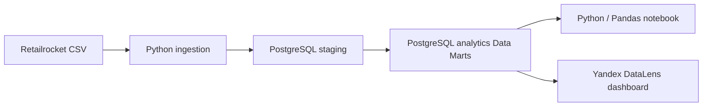

# Architecture — Marketplace Intelligence

> Status: implemented analytics MVP
> Database: PostgreSQL
> Primary objective: Product Analytics portfolio project

## 1. Implemented data flow



The current implementation deliberately keeps the architecture lean. Product metrics are calculated once in SQL Data Marts and reused by Python and BI.

## 2. Implemented PostgreSQL schemas

### staging

- `staging.stg_events`: one row per ingested source event, with a technical identity key, source identifiers, event type, UTC-naive event timestamp, source file and load timestamp.
- `staging.stg_categories`: category hierarchy rows with source category and parent identifiers.
- `staging.ingestion_batches`: ingestion metadata and file checksum used to skip repeat ingestion of the same file.

The event timestamp is converted from Unix milliseconds to UTC and stored as `TIMESTAMP WITHOUT TIME ZONE`. Treat it as UTC in all analysis.

### analytics

All current Data Marts are PostgreSQL materialized views built directly from `staging.stg_events`.

| Object | Grain | Purpose |
|---|---|---|
| `dm_daily_kpis` | One UTC date | Daily events, DAU, same-day user reach ratios |
| `dm_conversion_funnel` | Whole observation period | Baseline user reach by event type |
| `dm_weekly_retention` | Cohort week × elapsed week | Weekly cohort retention |
| `dm_user_segments` | One visitor | Event-frequency segments |
| `dm_temporal_activity` | UTC weekday × hour | Temporal activity distribution |

Schema and view DDL are stored in `sql/marts/` and should be executed in numeric order.

## 3. Metric ownership

- SQL Data Marts define business metric logic.
- Python loads the Data Marts, validates cross-mart consistency, visualizes results and supports descriptive analysis.
- DataLens should connect to the same PostgreSQL Data Marts.
- Metric definitions and interpretation caveats are documented in `docs/metric_dictionary.md`.

Do not independently redefine the same KPI in Python or BI.

## 4. Data quality and known limitations

- The source contains repeated visitor-item actions; these are not automatically duplicates.
- A small number of fully identical event rows were observed during profiling. The current staging table preserves ingested rows; deduplication is not silently applied in the marts.
- `transactionid` is expected to be NULL for view and add-to-cart events.
- Transaction event rows are not equivalent to unique transactions.
- Reliable price/currency fields are absent, so GMV, Revenue and AOV are not calculated.
- The category tree does not establish an `itemid → categoryid` mapping. Category performance analysis is excluded until a mapping is verified.
- The baseline funnel does not enforce event sequence and is not session-level.
- The retention mart contains observed cohort/week combinations only; missing rows should not automatically be interpreted as zero retention.
- Temporal metrics are UTC. They are not local-time-of-day metrics for visitors.

## 5. Materialized view refresh

Materialized views are snapshots. After new data is loaded into staging, refresh them:

```sql
REFRESH MATERIALIZED VIEW analytics.dm_daily_kpis;
REFRESH MATERIALIZED VIEW analytics.dm_conversion_funnel;
REFRESH MATERIALIZED VIEW analytics.dm_weekly_retention;
REFRESH MATERIALIZED VIEW analytics.dm_user_segments;
REFRESH MATERIALIZED VIEW analytics.dm_temporal_activity;
```

The current views do not depend on one another, so they can be refreshed independently.

## 6. Future extensions — not part of the current MVP

The following may be added if a real analytical requirement justifies the complexity:

- A CORE/star-schema layer with dimensions and event/transaction facts.
- Sessionization with a documented inactivity timeout.
- A strict sequential and session-level conversion funnel.
- A verified item-to-category mapping.
- Experiment assignment and exposure tables for real A/B tests.

These are future extensions. The current portfolio deliverable is a Product Analytics workflow, not a full enterprise Data Warehouse.
