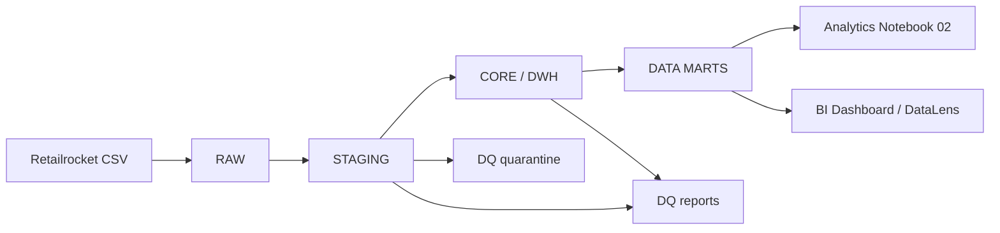
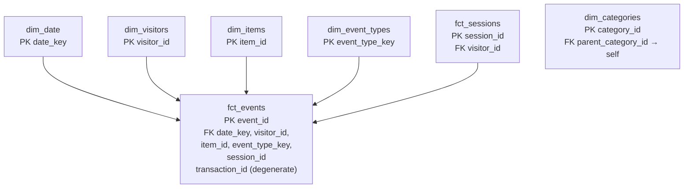

# DWH Architecture — Marketplace Intelligence

> Версия: 1.0  
> Статус: проектирование  
> Целевая СУБД: PostgreSQL

## 1. Цель

Построить воспроизводимый аналитический контур от исходных CSV до продуктовых метрик и BI. Бизнес-логика метрик централизуется в SQL/Data Marts. Ноутбуки используют готовые витрины, а не повторно рассчитывают KPI из сырых файлов.

## 2. Архитектура слоёв

### RAW
- Исходные файлы хранятся без изменений.
- RAW не коммитится в Git.
- Фиксируются источник, дата загрузки, имя файла, размер и checksum.
- Новая загрузка не должна незаметно перезаписывать предыдущую версию.

### STAGING
Назначение: привести типы, нормализовать timestamp и выявить проблемы качества, сохранив трассировку до источника.

Таблицы:
- stg_events
- stg_category_tree

Технические поля:
- load_id
- source_file
- loaded_at
- source_row_number (если загрузчик может достоверно зафиксировать номер строки)
- is_full_duplicate
- dq_status
- dq_reason

Исходный timestamp сохраняется как BIGINT; дополнительно создаётся event_at_utc TIMESTAMP. Неизвестные event types, transaction без transactionid и конфликтные транзакции получают статус quarantine.

### CORE / DWH
Dimensions:
- dim_date
- dim_visitors
- dim_items
- dim_categories
- dim_event_types

Facts:
- fct_events
- fct_sessions
- fct_transactions

Каждая таблица имеет PK, отношения — FK там, где это корректно. Факты трассируются до staging через source_load_id и при наличии source_row_number.

### DATA MARTS
Первая версия:
- dm_daily_product_kpis
- dm_conversion_funnel
- dm_user_retention
- dm_customer_segments
- dm_session_metrics

Витрины строятся из CORE, а не напрямую из CSV. Каждая витрина сопровождается описанием зерна и формул в docs/metric_dictionary.md.

## 3. Star Schema

Центральный факт — fct_events: какое событие, когда, кем и с каким товаром было совершено.

dim_categories показана отдельно, поскольку источник содержит иерархию категорий, но не подтверждённую связь с itemid. Не создавать FK dim_items.category_id → dim_categories.category_id, пока mapping не найден в item properties и не проверен.

Дополнительные факты:
- fct_sessions — одна строка на сессию; агрегирует события посетителя в пределах 30-минутного inactivity timeout.
- fct_transactions — одна строка на transactionid; агрегирует строки transaction events.

## 4. Ключи и связи

| Родитель | Дочерняя таблица | Связь | Условие |
|---|---|---|---|
| dim_visitors | fct_events | 1:M | visitor_id |
| dim_items | fct_events | 1:M | item_id |
| dim_date | fct_events | 1:M | date_key |
| dim_event_types | fct_events | 1:M | event_type_key |
| dim_visitors | fct_sessions | 1:M | visitor_id |
| dim_visitors | fct_transactions | 1:M | visitor_id |
| dim_categories | dim_categories | 1:M | parent_category_id; NULL у корней |

transaction_id в fct_events — degenerate dimension. При необходимости можно добавить FK на fct_transactions, но только после проверки целостности групп.

## 5. Сессии и транзакции

### Сессии
События сортируются по visitorid и event_at_utc. Если разница с предыдущим событием > 30 минут, начинается новая сессия. session_id — surrogate key. Способ его генерации должен быть стабильным при повторном пересчёте либо документирован как пересоздаваемый.

### Транзакции
Перед агрегацией transactionid проверить:
- один visitorid на транзакцию;
- согласованное время;
- отсутствие NULL itemid;
- повторы (transactionid, itemid).

Только после проверок строить fct_transactions. Нельзя считать каждую строку event=transaction отдельной транзакцией: профилирование показывает 22,457 строк и 17,672 уникальных transactionid.

## 6. Политика качества данных

| Проверка | STAGING | CORE |
|---|---|---|
| Полный дубль | Пометить и посчитать | Исключить по утверждённому правилу, сохранить DQ-аудит |
| Повтор visitor-item event | Сохранить | Сохранить |
| NULL transactionid для view/addtocart | Допустим | Сохранить NULL |
| NULL transactionid для transaction | Quarantine | Не включать в транзакционную агрегацию |
| Неизвестный event type | Quarantine | Не включать в стандартные KPI до разбора |
| NULL parentid | Допустим | Корневая категория |
| Несуществующий parentid | DQ error | Не публиковать неконсистентную иерархию |
| Конфликт visitor/time в transactionid | Quarantine группы | Не агрегировать до исправления |
| Некорректный timestamp | Quarantine | Не включать во временные витрины |

## 7. Метрики и ограничения

- DAU/WAU/MAU: distinct visitorid с хотя бы одним событием за период.
- Session count: количество сессий по правилу 30 минут.
- View-to-Cart CR: сессии с addtocart / сессии с view.
- Cart-to-Purchase CR: сессии с transaction / сессии с addtocart.
- Overall Purchase CR: сессии с transaction / сессии с view.
- Retention: когорта по неделе первого наблюдения; календарный W1 и точный D7 должны быть разделены.
- GMV, Revenue и AOV не рассчитываются: источник не содержит цены и валюты.

Знаменатели, временные границы, timezone и правила дедупликации должны совпадать в SQL, Python и BI.

## 8. Порядок реализации

1. Утвердить модель и ERD.
2. Создать DDL для staging и загрузить CSV.
3. Реализовать DQ checks и quarantine.
4. Создать dimensions и facts.
5. Реализовать сессии и агрегацию транзакций.
6. Создать data marts и сверить контрольные суммы.
7. Подключить Notebook 02 и BI.

## 9. Definition of Done

- [ ] Для каждой таблицы документировано зерно.
- [ ] Для каждой таблицы определён PK; для отношений — FK.
- [ ] Нет неподтверждённой связи товар-категория.
- [ ] Транзакции агрегируются по transactionid, а не по числу строк.
- [ ] NULL и дубли обрабатываются по единой политике.
- [ ] Сессии рассчитываются единым правилом 30 минут.
- [ ] SQL-модель воспроизводится на исходных данных.
- [ ] DQ-метрики показывают исключённые и карантинные записи.
